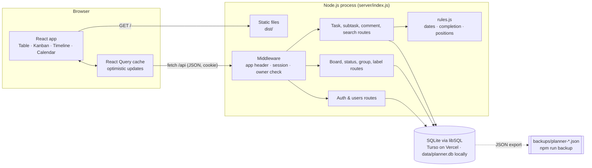

# Architecture

The same code runs two ways:

- **Vercel:** the built React app is served from Vercel's CDN, `/api/*` runs `api/index.js` as a serverless function, and data lives in a Turso (hosted SQLite) database.
- **Self-hosted:** one Node.js process serves both the API and the React app, and keeps data in a local SQLite file.



## Decisions

| Decision | Why |
|---|---|
| Node + Express 5 + libSQL (`@libsql/client`) | One SQLite schema for both a local file and Turso. Remote connections use libSQL's HTTP client, so Vercel needs no native binary. |
| Explicit child deletes instead of relying on `ON DELETE CASCADE` | Behaves the same whether or not the database enforces foreign keys. |
| Migrations tracked in a `_migrations` table | Applied automatically on start (or the first request after a Vercel deploy). |
| React + TypeScript + Vite, React Query, dnd-kit | Fast typed UI; React Query gives optimistic drag-and-drop with rollback on error; dnd-kit supports mouse, touch and keyboard. |
| Plain CSS with tokens in `client/src/theme.css` | The brand can be swapped in one file once the innov-8.co.za colours and fonts are confirmed. |
| Cookie sessions (httpOnly, SameSite=Lax, token stored hashed) + required `X-Requested-With` header | Simple, secure sign-in for a small team; the header blocks cross-site form posts. |
| Fractional `position` on tasks | A drop only updates the moved task. |

## Folder layout

```
api/           Vercel serverless entry (wraps the Express app)
server/        API (Express), schema & migrations, rules, seed, backup, restore
client/        React app (Vite root); theme.css holds the brand
tests/         Vitest API + rules tests; e2e/run.js Playwright happy path
docs/          research brief, roadmap, spec, architecture, planning page
```

## Security and privacy (POPIA)

- Passwords hashed with scrypt; sessions expire after 30 days; sign-in rate-limited.
- All input validated server-side with zod; all SQL parameterised.
- Data stays on your own server: names, emails and work content only. No third-party analytics or trackers.
- Run behind HTTPS (Caddy, Nginx or Cloudflare Tunnel) and set `TRUST_PROXY=1` so cookies are marked Secure.
