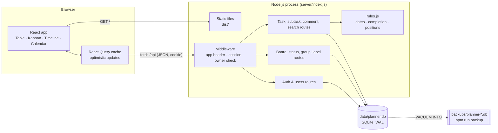

# Architecture

One Node.js process serves both the API and the built React app, and keeps all data in one SQLite file. There is nothing to pay for and nothing else to run.



## Decisions

| Decision | Why |
|---|---|
| Node + Express + `node:sqlite` (built into Node 22) | No native modules to compile, no database server, runs on any machine with Node 22.13+ or Docker. |
| React + TypeScript + Vite, React Query, dnd-kit | Fast typed UI; React Query gives optimistic drag-and-drop with rollback on error; dnd-kit supports mouse, touch and keyboard. |
| Plain CSS with tokens in `client/src/theme.css` | The brand can be swapped in one file once the innov-8.co.za colours and fonts are confirmed. |
| Cookie sessions (httpOnly, SameSite=Lax, token stored hashed) + required `X-Requested-With` header | Simple, secure sign-in for a small team; the header blocks cross-site form posts. |
| Fractional `position` on tasks | A drop only updates the moved task. |
| Migrations in `server/db.js` keyed on `PRAGMA user_version` | Upgrades run automatically on start. |

## Folder layout

```
server/        API (Express), schema & migrations, rules, seed, backup
client/        React app (Vite root); theme.css holds the brand
tests/         Vitest API + rules tests; e2e/run.js Playwright happy path
docs/          research brief, roadmap, spec, architecture, planning page
```

## Security and privacy (POPIA)

- Passwords hashed with scrypt; sessions expire after 30 days; sign-in rate-limited.
- All input validated server-side with zod; all SQL parameterised.
- Data stays on your own server: names, emails and work content only. No third-party analytics or trackers.
- Run behind HTTPS (Caddy, Nginx or Cloudflare Tunnel) and set `TRUST_PROXY=1` so cookies are marked Secure.
