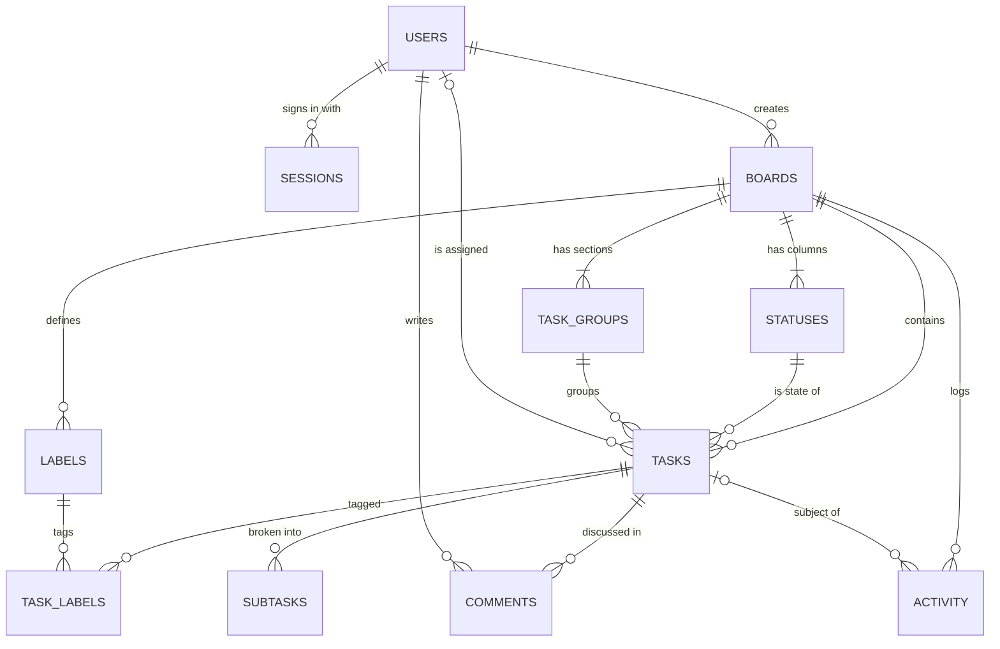

# Orchestr8: Product Spec

Source: `roadmap-innov8-planner.md` (Development handoff). Users: **Owner** (manages team and boards) and **Designer** (member).

## User stories and acceptance criteria

| # | Story | Acceptance criteria |
|---|-------|---------------------|
| U1 | As the owner, I set up the app the first time. | With no users, the app shows "Set up your studio"; submitting name/email/password creates an owner and signs in. Setup is refused (409) once any user exists. |
| U2 | As a user, I sign in and stay signed in. | Wrong password shows "That email and password do not match." Session lasts 30 days. More than 10 attempts in 15 minutes returns 429. |
| U3 | As the owner, I add my designer. | Settings > Team > Add member creates a user with a temporary password. Members cannot add users (403). |
| U4 | As a user, I create a board per client or stream of work. | New board starts with statuses To do / In progress (WIP 4) / Client review / Done, groups This week / Next up, and four labels. |
| U5 | As a user, I see my week at a glance. | Home shows counts (open, due in 7 days, overdue) and my open tasks bucketed Overdue / Next 7 days / Later / No date, across all boards. |
| U6 | As a user, I move work across a Kanban board. | Cards drag between and within columns (mouse, touch, keyboard). The column shows count / WIP limit and a warning when over. Moving into a "done" status stamps `completed_at`; moving out clears it. |
| U7 | As a user, I edit many tasks fast in a table. | Table view groups rows; status, owner, priority, start, due and title edit inline; "+ Add task" per group. |
| U8 | As a user, I see the schedule. | Timeline shows bars from start to due date over 4/8/12 weeks with a today line. Calendar shows tasks on their due date by month; "+" on a day adds a task due that day. |
| U9 | As a user, I keep all task detail in one place. | Task drawer: title, status, owner, priority, group, dates, labels, description, subtasks, comments and activity. Start after due is rejected with a clear message. |
| U10 | As a user, I find things. | Board filter by text, person, label, hide done. Global search across active boards by title/description. |
| U11 | As a user, I shape a board to the project. | Board settings: rename, recolour, archive/restore; add, rename, recolour, reorder and delete statuses and groups (tasks move to a chosen replacement); WIP limits; done flag; labels. |
| U13 | As the owner, I start a client website job without retyping the plan. | New board → Start from “Website project (6–8 weeks)” + start date creates groups Discovery/Design/Build/Review/Launch and 14 dated tasks with owners, labels and subtasks. |
| U14 | As the owner, I move a Monday.com board across without retyping it. | New board → Import from Monday.com → choose the “Export board to Excel” file (or CSV). A preview shows groups, items, subitems, updates, how columns map and who each Monday.com person becomes; Import creates the board in one step. Statuses keep their Monday.com names; finished ones (Done, Complete…) count as done. |
| U12 | As the owner, I keep data safe. | `npm run backup` writes a consistent copy and keeps the newest 30. Deleting a board requires archiving first and is owner-only. |

## Entity model

| Entity | Key fields | Rules |
|---|---|---|
| users | name, email (unique, case-insensitive), password_hash (scrypt), role owner/member, color, active | Removing a user deactivates them and unassigns their tasks; at least one owner always remains. |
| sessions | id = SHA-256 of cookie token, user_id, expires_at | Token only ever stored hashed. |
| boards | name, description, color, archived | Delete only when archived. |
| statuses | name, color, position, wip_limit, is_done | Board keeps at least one. |
| task_groups | name, color, position | Board keeps at least one. |
| labels | name, color | Deleting removes it from tasks. |
| tasks | title, description, status_id, group_id, assignee_id, priority, start_date, due_date, position, completed_at | Status/group/labels must belong to the same board; start ≤ due. |
| task_labels | task_id, label_id | Composite key. |
| subtasks | title, done, position | |
| comments | body, user_id | Author or owner may delete. |
| activity | action, detail (JSON), user_id, task_id | Written on create, status, assignee, due date, rename, comment, delete. |

## API contract

All endpoints are under `/api`, JSON in and out. State-changing requests must send `X-Requested-With: innov8`. Errors use Problem Details: `{ type, title, status, detail, errors? }` where `errors` maps field to message.

| Method | Path | Body / query | Success | Errors |
|---|---|---|---|---|
| GET | /auth/state | | 200 `{needsSetup, user}` | |
| POST | /auth/setup | name, email, password | 201 `{user}` + cookie | 400, 409 |
| POST | /auth/login | email, password | 200 `{user}` + cookie | 400, 401, 429 |
| POST | /auth/logout | | 204 | |
| GET | /users | | 200 User[] | 401 |
| POST | /users | name, email, password, role | 201 User | 400, 403 |
| PATCH | /users/:id | name?, color?, role? | 200 User | 400, 403, 404 |
| DELETE | /users/:id | | 204 | 400, 403 |
| POST | /me/password | currentPassword, newPassword | 204 | 400 |
| POST | /boards/import | name, statuses[], groups[], tasks[] (with subtasks[] and comments[]) | 201 Board | 400 |
| GET | /templates | | 200 `[{id, name, description, tasks}]` | |
| GET | /boards | `?archived=1` | 200 Board[] with task/done/overdue counts | |
| POST | /boards | name, description?, color?, template?, start_date? | 201 Board | 400 |
| GET | /boards/:id | | 200 `{board, statuses, groups, labels, tasks}` | 404 |
| PATCH | /boards/:id | name?, description?, color?, archived? | 200 Board | 400, 404 |
| DELETE | /boards/:id | | 204 | 400 (not archived), 403 |
| GET | /boards/:id/activity | | 200 Activity[] (latest 100) | 404 |
| POST | /boards/:id/statuses · /groups · /labels | name, color, (wip_limit, is_done, position) | 201 | 400, 404 |
| PATCH | /statuses/:id · /groups/:id · /labels/:id | partial | 200 | 400, 404 |
| DELETE | /statuses/:id · /groups/:id | `?moveTo=<id>` | 204 | 400 (last one / bad target) |
| DELETE | /labels/:id | | 204 | |
| POST | /boards/:id/tasks | title + optional task fields, label_ids | 201 Task | 400, 404 |
| GET | /tasks/:id | | 200 `{task, subtasks, comments, activity}` | 404 |
| PATCH | /tasks/:id | any task fields, label_ids | 200 Task | 400, 404 |
| DELETE | /tasks/:id | | 204 | 404 |
| POST | /tasks/:id/subtasks | title | 201 | 400 |
| PATCH / DELETE | /subtasks/:id | title?, done? | 200 / 204 | 404 |
| POST | /tasks/:id/comments | body | 201 | 400 |
| DELETE | /comments/:id | | 204 | 403 |
| GET | /my-tasks | | 200 open tasks assigned to me | |
| GET | /search | `?q=` (2+ chars) | 200 up to 20 hits | |

Lists are small for a two-person studio, so they are returned whole rather than paginated; activity and search are capped.

## Screens

1. Sign in / first-run setup
2. Home: week summary, My tasks, board cards
3. Board: header, view tabs, filters; Table, Kanban, Timeline, Calendar
4. Task drawer (slides over any board view; URL `?task=<id>` so links can be shared)
5. Board settings modal (Board, Statuses, Groups, Labels)
6. Activity modal
7. Settings & team: profile, appearance (system/light/dark), team, password, archived boards
